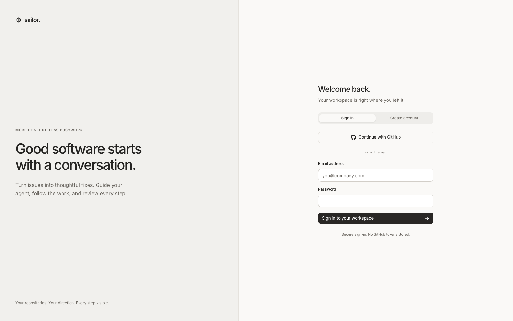

<p align="center">
  <picture>
    <source media="(prefers-color-scheme: dark)" srcset="assets/logo-dark.svg" />
    
  </picture>
</p>

<h1 align="center">Sailor</h1>

<p align="center">
  <strong>An engineering workspace where a conversation becomes shipped work.</strong><br />
  Ask for a change, attach a repository, and follow the agent as it reproduces,
  fixes, tests, and publishes it inside an isolated microVM.
</p>

<p align="center">
  <a href="LICENSE"></a>
  <a href="https://github.com/hrithikkoduri/anchor-ai-sdk"></a>
  
  
</p>

<p align="center">
  
</p>

## What it is

A thread is more than a prompt. It carries one conversation, one repository,
one retained sandbox, and every run that follows — so work survives a lost
worker, an exhausted budget, or an answer you give an hour later.

Sailor owns the product layer: threads, runs, traces, GitHub, sandboxes,
secrets, and the dashboard. The agent runtime — the loop, budgets, compaction,
checkpointing, revival — is [Anchor](https://github.com/hrithikkoduri/anchor-ai-sdk),
consumed from npm.

| Capability | What it means |
|---|---|
| **Threads, not prompts** | Start from a goal or a labeled GitHub issue. Optionally attach a repository; publish when you are ready. |
| **Isolation by default** | Every run boots a Heyo Firecracker microVM. E2B is supported; the local backend is for development. |
| **Durable runs** | Postgres is the truth. Leases and heartbeats detect dead workers and resume; checkpoints go to a side branch. |
| **Evidence-gated delivery** | `publish_changes` refuses to ship unless a green `run_tests` matches the exact tree being delivered. |
| **Traces, not guesses** | Each run writes an NDJSON journal with steps, tokens, cost, and duration. The PR links straight to it. |
| **Questions that pause** | `ask_questions` stops the run and resumes the same conversation and sandbox when you answer. |
| **GitHub when you want it** | Issues are one entry point, not the definition. CI failures and review comments wake the same thread. |
| **Secrets stay server-side** | `run_with_secret` decrypts one value for one command and strips it from the observation. |

## How it works

```
conversation or triaged issue
  → intake (Hono)        authorize · resolve thread · enqueue
  → worker (BullMQ)      one run per thread · heartbeats · resume-safe
  → agent in a microVM   clone · reproduce · fix · run the repo's own tests
  → publish_changes      explicit, access-checked delivery
  → pull request         with the trace attached
```

| Path | Role |
|---|---|
| `apps/server` | Hono API, webhooks, CLI, and the long-lived worker |
| `apps/dashboard` | React workspace: threads, chat, traces, settings (Vite) |
| `packages/contracts` | Shared API types and Zod schemas |
| `image/` | Toolchain image the microVMs boot from |
| `fixtures/` | A tiny buggy library used by the end-to-end tests |

The layering rule is one-way: `db → services → http → dashboard`. Services own
SQL and transactions; routes only parse, authorize, and shape responses.

## Quickstart

Node 20+, Docker, an LLM key, and a sandbox backend (Heyo by default, or
`--local`). Repository-backed work needs a GitHub App —
[about three minutes to set up](docs/github-app.md). Everything environment-shaped
lives in [`.env.example`](.env.example).

```bash
git clone https://github.com/hrithikkoduri/sailor.git && cd sailor
npm install
cp .env.example .env      # LLM_API_KEY · HEYO_TOKEN (or --local) · GITHUB_APP_*
npm run doctor            # env, services, sandbox health
npm run dev               # Postgres + Redis + migrate + serve + worker + dashboard
```

Then pick a way in:

- **Dashboard** — `http://localhost:5173`. Start a thread, attach a repository,
  and watch the run.
- **GitHub** — label an issue `agent:fix` on an enabled repository. Point the
  App's webhook at `ngrok http 8787`.
- **CLI** — `npm run sailor -- run <repo> <issue>` runs the same engine with no
  webhooks. Add `--verbose` for model output, `--keep` to keep the sandbox.

## Commands

| Task | Command |
|---|---|
| Everything locally | `npm run dev` |
| API only / worker only | `npm run serve` · `npm run worker` |
| Dashboard only | `npm run dev -w apps/dashboard` |
| Environment and service check | `npm run doctor` |
| Apply migrations | `npm run migrate` |
| New migration after editing `db/schema.ts` | `npm run db:generate` |
| One run, no webhooks | `npm run sailor -- run <repo> <issue>` |
| Typecheck / build | `npm run typecheck` · `npm run build` |
| Unit / integration / UI tests | `npm test` · `npm run test:integration` · `npm run test:ui` |

`npm run db:generate` writes SQL under `apps/server/drizzle/`; `npm run migrate`
applies pending files and is safe to re-run.

## Run as a container

One image, three commands. It bakes the dashboard and serves it from the same
origin as the API.

```bash
docker build -t sailor .
docker run --rm -p 8787:8787 --env-file .env sailor           # serve
docker run --rm --env-file .env sailor worker                 # queue consumer
docker run --rm --env-file .env sailor migrate                # schema, one-off
```

`GET /healthz` checks the process; `GET /readyz` checks Postgres and Redis and
returns 503 until both answer. When the container reaches host services, point
`DATABASE_URL` and `REDIS_URL` at `host.docker.internal`.

Core stops at a runnable image. Hosted infrastructure and deployment belong to
the private `sailor-cloud` package.

## Docs

- [`docs/github-app.md`](docs/github-app.md) — create and configure the GitHub App.
- [`AGENTS.md`](AGENTS.md) — repository map, layering, invariants, conventions.
- [`DECISIONS.md`](DECISIONS.md) — every architectural choice, why, and what it supersedes.
- [`ROADMAP.md`](ROADMAP.md) — deferred work with the trigger that pulls it back.
- [Anchor](https://github.com/hrithikkoduri/anchor-ai-sdk) — the runtime, its
  [decision log](https://github.com/hrithikkoduri/anchor-ai-sdk/blob/main/DECISIONS.md),
  and [SWE-bench Lite results](https://github.com/hrithikkoduri/anchor-ai-sdk/tree/main/evals/benchmarks/swe-bench/results).

## Status

Early alpha, and honest about it. The full loop runs end-to-end: a conversation
or issue becomes a reviewed PR with traces, and durable turns, revival, and
evidence gates are exercised by the package's conformance and evaluation suites.

## License

Sailor core is **Apache 2.0** ([LICENSE](LICENSE)): use, modify, and distribute
it for any purpose, including commercial, with an explicit patent grant and no
copyleft. The hosted layer lives in `sailor-cloud`.
